# Systems Architecture

Engine: Unreal Engine 5.4+ · Module: `RavensCreed` (C++) · Code: [`Source/RavensCreed`](../Source/RavensCreed)

## Principles

1. **One source of truth for consequences.** Every decision writes named flags into `URCWorldStateSubsystem`. Quests,
   dialogue, ending slides, world data layers and AI read flags. No system keeps a private copy of "what happened".
2. **Records outlive actors.** NPCs are persistent records in `URCSocialSubsystem`; actors are views that stream in
   and out. A smith killed in Jórvík is dead whether or not Jórvík is loaded.
3. **Data-driven content.** Dialogue, quests, schedules, weapons and weather presets are data assets or tables. Writers
   can author dialogue as JSON and import it; the validator (`Tools/validate_dialogue.py`) checks it against the C++
   types in CI.
4. **Weather is a service.** Rendering, audio, AI, traversal and combat all query one `URCWeatherSubsystem`, so the
   storm the player sees is the storm the guards are blinded by.
5. **Blueprint-friendly C++.** Systems are C++ with `BlueprintCallable`/`BlueprintAssignable` surfaces; designers build
   UI, cinematics and level scripting in Blueprint against those hooks.

## Module layout

```
Source/RavensCreed/
  Public|Private/
    Core/      RCTypes, RCWorldStateSubsystem, RCAlignmentSubsystem, RCSaveGame, RCSaveSubsystem
    Weather/   RCWeatherTypes (state, presets, project settings), RCWeatherSubsystem
    Social/    RCSocialTypes, RCSocialSubsystem, RCNPCComponent (+ schedule asset), RCNPCCharacter
    Dialogue/  RCDialogueTypes, RCDialogueAsset (JSON import + validation), RCDialogueManager
    Quest/     RCQuestTypes (quest asset), RCQuestSubsystem
    Player/    RCPlayerCharacter, RCParkourComponent, RCCombatComponent (+ weapon data), RCRavenSightComponent
```

Dependencies: `Core, CoreUObject, Engine, InputCore, EnhancedInput, AIModule, NavigationSystem, Niagara, MotionWarping,
DeveloperSettings` (public) and `Json, JsonUtilities, PhysicsCore` (private). Plugins: Enhanced Input, Niagara, Motion
Warping, StateTree, Mass Gameplay.

## Class map

```mermaid
classDiagram
  direction LR
  class URCWorldStateSubsystem { <<GameInstanceSubsystem>> SetFlag() GetFlag() AdvanceTime() GetSeason() OnFlagChanged OnHourPassed }
  class URCAlignmentSubsystem { <<GameInstanceSubsystem>> ApplyDelta() GetDominantAxes() GetTitle() }
  class URCSaveSubsystem { <<GameInstanceSubsystem>> SaveGame() LoadGame() }
  class URCWeatherSubsystem { <<TickableWorldSubsystem>> RequestWeather() GetWindAt() GetSurfaceGrip() GetVisibilityMultiplier() GetNoiseMultiplier() GetColdDamagePerSecond() OnLightningStrike }
  class URCSocialSubsystem { <<WorldSubsystem>> ReportEvent() NotifyNPCKilled() GetDisposition() Remembers() SpreadRumours() }
  class URCDialogueManager { <<WorldSubsystem>> StartDialogue() SelectChoice() EvaluateAll() ApplyAll() OnLine OnChoices OnDialogueEvent }
  class URCQuestSubsystem { <<WorldSubsystem>> StartQuest() SetStage() CompleteQuest() }
  class ARCPlayerCharacter { Parkour Combat RavenSight Health Stamina PerformInteraction() }
  class ARCNPCCharacter { NPC Health Poise }
  class URCNPCComponent { NPCId Schedule Dialogue Needs ChooseActivity() TryPickpocket() }
  URCAlignmentSubsystem --> URCWorldStateSubsystem : mirrors ALIGN_* flags
  URCSocialSubsystem --> URCWorldStateSubsystem : DEAD_*, VENGEANCE_*, REP_*
  URCSocialSubsystem --> URCWeatherSubsystem : witness range
  URCQuestSubsystem --> URCWorldStateSubsystem : listens OnFlagChanged
  URCQuestSubsystem --> URCDialogueManager : shares condition/effect evaluator
  URCDialogueManager --> URCSocialSubsystem
  URCDialogueManager --> URCAlignmentSubsystem
  URCDialogueManager --> URCQuestSubsystem
  URCWeatherSubsystem --> URCWorldStateSubsystem : drives the clock
  ARCPlayerCharacter *-- URCParkourComponent
  ARCPlayerCharacter *-- URCCombatComponent
  ARCPlayerCharacter *-- URCRavenSightComponent
  ARCNPCCharacter *-- URCNPCComponent
  URCNPCComponent --> URCSocialSubsystem : registers record
  URCSaveSubsystem ..> URCWorldStateSubsystem : IRCSaveable
  URCSaveSubsystem ..> URCSocialSubsystem : IRCSaveable
  URCSaveSubsystem ..> URCWeatherSubsystem : IRCSaveable
```



## Lifetimes

| System | Lifetime | Why |
|---|---|---|
| World state, alignment, save | `UGameInstanceSubsystem` | Survive level travel (Norway to England) |
| Weather, social, dialogue, quests | `UWorldSubsystem` | Need the world (traces, actors, timers); state round-trips through the save object on travel |
| NPC component | Actor component | View of a persistent record |

On level travel, world subsystems must hand their state across. Planned (not yet in the code): `URCSaveSubsystem`
writes an in-memory snapshot before travel and reads it after the new world's `OnWorldBeginPlay`, reusing the
save/load path. Today, the save object already carries everything those subsystems hold.

## The consequence pipeline (one choice, end to end)

1. Player picks "Feed them lies, feed me truth" in `DLG_DrownedOath_Thorvald`.
2. `URCDialogueManager::SelectChoice` evaluates the choice's conditions (proof, Shadow ≥ 25) and applies its effects:
   flags (`THORVALD_DOUBLE_AGENT=1`, `DO_OUTCOME=2`, `CLANS_UNITED=1`, `FLEET_SIZE=12`), alignment (Cunning +8,
   Ambition +4), a `Remember Spared` social event, trust, companion approval (only for companions with `PARTY_*` set).
3. `URCWorldStateSubsystem::SetFlag` records each change in the ledger and broadcasts `OnFlagChanged`.
4. `URCQuestSubsystem` re-evaluates active quests; *The Drowned Oath* completes with outcome `Turned` and writes
   `OUTCOME_DrownedOath_Turned`.
5. Later content reads it: *The Grey-Hood* unlocks an intel branch; the fleet size scales Act I's naval battle; an ending
   slide line for Thorvald is selected.
6. `URCSaveSubsystem` persists flags, ledger, records and quest states in one `URCSaveGame`.

## Condition/effect language

Dialogue choices, dialogue entries, quest stages, quest outcomes and quest fail rules share one evaluator
(`URCDialogueManager::EvaluateAll` / `ApplyAll`). Conditions: flags, alignment thresholds, NPC opinion, alive/dead,
memories, weather, night, companion state, silver. Effects: flags, alignment, opinion/fear/trust, social memory events,
faction reputation, companion approval and state, quest start/stage/complete, silver, scripted events, weather requests.
Adding a type means one enum value plus one `case` in each switch, and the validator picks it up automatically.

## AI integration

- **Brains:** `URCNPCComponent` does utility scoring every 2 s (schedule vs. hunger, rest, warmth, safety, weather
  misery, duty) and writes `Activity`, `SpotTag` and `Suspicion` to the AI controller's blackboard.
- **Bodies:** a Behavior Tree (or StateTree) per archetype reads those keys: *Go to spot with tag → play activity
  montage*, *Flee*, *Investigate suspicion*, *Combat*. Spots are level actors tagged with activity names.
- **Perception:** AI Perception sight radius is set from `URCNPCComponent::GetSightRange()` (weather, night,
  alertness); hearing scales by `ARCPlayerCharacter::GetNoiseLevel() * URCWeatherSubsystem::GetNoiseMultiplier()`.
- **Group tactics:** an EQS-backed squad manager assigns roles (shield-wall anchor, flanker, archer on high ground)
  and reads morale from the social records (leader dead, fear of Bjorn, lightning nearby).
- **Crowds:** beyond ~40 m, townsfolk are Mass entities with LOD'd schedules; promoting an entity to a full actor
  hydrates it from its social record.

## Animation

- Locomotion: Motion Matching (UE 5.4 Pose Search) with a trajectory-predicting character movement setup; distance
  matching for starts and stops; foot-locking IK on uneven ground and slopes.
- Traversal: root-motion montages with Motion Warping targets set by `URCParkourComponent` (`ParkourTarget`) and
  `URCCombatComponent` (`AssassinTarget`), so animations land exactly on ledges and victims.
- Combat: montage sections per combo step; anim notify states call `BeginHitWindow`/`EndHitWindow` and
  `OpenComboWindow`; additive hit reactions blended by poise.
- Cloth: Chaos Cloth for cloaks, furs and sails, driven by a wind component that samples `GetWindAt` each frame.

## Rendering hooks

- Material Parameter Collection `MPC_Weather`: `RC_Wetness, RC_Snow, RC_Rain, RC_WindX, RC_WindY, RC_WindSpeed,
  RC_Cloud, RC_Fog, RC_Aurora, RC_Lightning`. Every master material includes the `MF_Weather` function (see the
  [weather plan](03-Weather-System.md)).
- Raven Sight: custom-depth stencil values 1–5 read by `PP_RavenSight` (outline + tint per category).

## Testing

| Layer | How |
|---|---|
| Dialogue/quest data | `Tools/validate_dialogue.py` in CI (keys, enums, links, reachability, points of no return, outcome map) |
| Systems | Unreal Automation Tests (`IMPLEMENT_SIMPLE_AUTOMATION_TEST`): alignment diminishing returns, flag ledger, rumour spread over N hours on a synthetic town, weather Markov chain distribution per season, save round-trip equality |
| Gameplay | Functional tests in test maps: climb-up on 20 ledge profiles, vault/mantle thresholds, assassination angles |
| Branch coverage | A headless "flag player" that walks quest graphs with random choices and asserts each ending is reachable and no flag combination dead-ends |
| Performance | Gauntlet + Insights traces on the Valdrheim slice: 60 fps on PS5 performance mode, 30 fps quality |

## Console commands

| Command | Effect |
|---|---|
| `rc.Weather <Type> [blendHours]` | Force weather (Clear, Overcast, Fog, Drizzle, Rain, Thunderstorm, Snow, Blizzard, AuroraNight) |

Planned: `rc.Flag <Name> <Value>`, `rc.Rumours.Step <hours>`, `rc.NPC.Dump <Id>`, `rc.Ending.Preview`.
