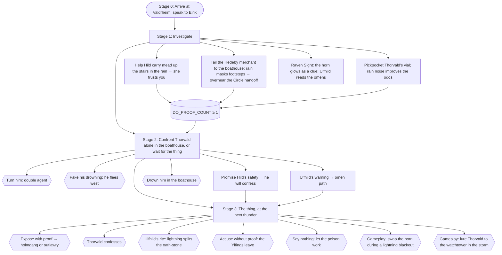

# Sample Quest: *The Drowned Oath*

Act I, main saga. Location: Valdrheim, the stave hall on the sea-cliff (Western Fjords). Weather: locked thunderstorm.

Data: [`DLG_DrownedOath_Thorvald.json`](../Content/Data/Dialogue/DLG_DrownedOath_Thorvald.json) (26 nodes, 27 choices) ·
[`DLG_DrownedOath_Hild.json`](../Content/Data/Dialogue/DLG_DrownedOath_Hild.json) (8 nodes). Both import into
`URCDialogueAsset` and pass `Tools/validate_dialogue.py`.

## Premise

Jarl **Eirik Brandson** of Clan Hrafnsson calls a *thing* to bind his clan and the Ylfings of Jarl **Sigrid Ironhair**
into one summer fleet. The oath is sworn on one drinking horn, carried by **Hild**, daughter of the lawspeaker **Thorvald
Grimsson**. Thorvald is drowning in silver debt to the Gullbrand Circle, which has given him a vial: if Sigrid dies
drinking from a Hrafnsson horn, the clans go to war and both owe the Circle for weapons. Bjorn arrives at dusk as the
storm rolls in.

## Cast

| Id | Name | Faction | Personality (brave, greed, moral, gossip, pious) | Bonds |
|---|---|---|---|---|
| Eirik | Jarl Eirik Brandson | Hrafnsson | 0.7, 0.4, 0.6, 0.3, 0.5 | Sworn to Bjorn's clan; rival of Sigrid (−0.2) |
| Sigrid | Jarl Sigrid Ironhair | Ylfings | 0.9, 0.3, 0.5, 0.2, 0.6 | Old feud with Eirik (−0.3) |
| Thorvald | Thorvald Grimsson, lawspeaker | Hrafnsson (Circle debtor) | 0.3, 0.6, 0.5, 0.2, 0.7 | Daughter Hild (0.95) |
| Hild | Hild Thorvaldsdottir | Hrafnsson | 0.5, 0.2, 0.8, 0.6, 0.6 | Father Thorvald (0.9) |
| Ulfhild | Ulfhild the Völva (companion) | — | — | Party member if recruited earlier |

## Structure



**Stages** (`URCQuestAsset` *DrownedOath*):

| Stage | Journal | Advances when |
|---|---|---|
| 0 | Jarl Eirik has called a thing at Valdrheim. Speak with him. | Talk to Eirik |
| 1 | The lawspeaker hasn't slept since a Hedeby merchant came. Find out why. | `DO_LEAD_MERCHANT` or `DO_SUSPICION ≥ 1` |
| 2 | Thorvald plans to poison the oath-horn. Stop him, or use it. | `DO_PROOF_COUNT ≥ 1` |
| 3 | The horn goes round at the next thunder. | Feast trigger sets `DO_AT_THING` |

Fail rules: `NPCDead: Eirik` before stage 3 fails the quest (the thing never happens; the act branches to *Who Holds the
Fjord* with Eirik's heir).

## Gameplay solutions outside dialogue

| Solution | Systems | How |
|---|---|---|
| **Overhear the handoff** | Stealth, weather, social | Rain lowers the merchant's hearing range (`GetNoiseMultiplier`); stay unseen in the boathouse rafters (parkour). Sets `DO_PROOF_LETTER`, `DO_PROOF_COUNT += 1` |
| **Pickpocket the vial** | `URCNPCComponent::TryPickpocket` | Better odds from behind, in the rain, while Thorvald prays at the shrine. Failure is a public theft: Thorvald hides the vial in the horn's lining, and stage 3 becomes a race |
| **Swap the horn** | Interaction during a lightning blackout | Each lightning strike near the hall (`OnLightningStrike`) blows the torches for 3 s. Swap the poisoned horn for Thorvald's own cup. At the toast, Thorvald drops dead and the hall calls it the gods' judgment. Sets `DO_OUTCOME=6`. Hild's opinion depends on whether she saw you near the cups |
| **Tower in the storm** | Weather, social | Persuade or trick Thorvald up the watchtower (tag `Conductive` on the iron brazier). Lightning targeting favours tall conductive things. If the storm kills him, the killer is recorded as `Storm`, not Bjorn: `DO_OUTCOME=9`, Piety reactions, Ulfhild approval |
| **Assassinate on the cliff path** | Combat, parkour | Air assassination from the stair scaffolding. Witness checks use storm visibility. Body found at dawn; the Circle is alerted unless the body goes into the sea |

## Outcomes and consequences

The validator walks every path. This table is its output, plus the two gameplay-only outcomes.

| Outcome (`DO_OUTCOME`) | Path | Clans | Fleet | Thorvald | Hild | Alignment | Companions | Later effects |
|---|---|---|---|---|---|---|---|---|
| **Exposed** (1) | Proof at the thing → holmgang or outlawry | United | 12 | Dead in duel, or outlaw | Grieving, or under your protection | Honor +13 | Astrid +12, Kári +10 (duel); Aelfric +6 (law) | Ylfing and Hrafnsson reputation +10–15; outlaw Thorvald may reappear in Act II as a Circle agent |
| **Confessed** (1) | Promise Hild's safety → he confesses | United | 14 | Judged; dies cleaner | Freed (if promised) | Honor +8 to +14 | — | Best fleet; Hild and Eirik remember a kept oath |
| **Turned** (2) | Private confrontation → double agent | United | 12 | Alive, your spy | Safe | Cunning +8, Ambition +4 | Snorri +10, Astrid −5 | `THORVALD_DOUBLE_AGENT`: intel branch in *The Grey-Hood*; risk of discovery in Act II |
| **Omen** (3) | Ulfhild's rite; lightning splits the oath-stone | United | 12 | Confesses in terror | Grieving | Piety +10 | Ulfhild +15, Aelfric −5 | Skalds tell it as a miracle; Piety-gated lines open |
| **False accusation** (4) | Accuse without proof | Split | 4 | Free, alerted | Unaffected | Honor +2 | — | Ylfings −25; `CIRCLE_ALERTED`: harder Ring contracts; Eirik's trust −20 |
| **Exploited** (5) | Crown 35: let the poison work | Feud | 8 (yours) | Free | Fled | Ambition +12, Honor −12 | Astrid −20, Ulfhild −10, Kári +8 | Sigrid dies; `BJORN_WARLEADER`: Act I ends with Bjorn leading a war-band; *Gilded Chain* and *Iron Crown* endings favoured |
| **Swapped** (6) | Gameplay: swap the horn | United | 12 | Dead, "struck by the gods" | Depends on witnesses | Cunning +6 | Snorri +8 | Nobody knows (unless Hild saw you) |
| **Assassinated** (7) | Drown him in the boathouse | United | 10 | Dead | Grieving; vengeful if she learns | Honor −11, Cunning +4 | Astrid −10, Kári +5 | `VENGEANCE_Hild` if she finds out (H_MOURN); she returns in Act II |
| **Fled** (8) | Fake his drowning; he rows west | United | 10 | Exiled alive | Abandoned | Cunning +6, Honor −2 | Snorri +8 | He can turn up in Jórvík |
| **Storm judgment** (9) | Gameplay: tower in the storm | United | 12 | Killed by lightning (killer `Storm`) | Grieving | Piety +6 | Ulfhild +10 | The omen reading of the night is remembered across the fjords |

## Dialogue tree (Thorvald, abridged)

Full text and every condition and effect are in the JSON. Locked options show their requirement in the UI.

```
Entry: alone in the boathouse with DO_PRIVATE → P0
P0  Thorvald: "You walk softly for a man your size..."
 ├─ [Oath]   "I know about the poison. Confess at the thing..."     needs proof        → P_OFFER
 │    ├─ [Oath, no return]   "Hild walks free. You have my word."   Honor +6, Astrid +10 → P_ACCEPT (stage 3: will confess)
 │    ├─ [Shadow, no return] "Then don't hang. Drown."              Cunning +6, Snorri +8 → P_FLEE  (outcome Fled)
 │    └─ [Crown]   "Your debts become mine..."                      needs Crown 20      → P_TURN
 ├─ [Shadow] "The Circle owns your debts. I could own them instead." needs proof, Shadow 25 → P_TURN
 │    ├─ [Shadow, no return] "Feed them lies, feed me truth..."     Cunning +8, Ambition +4 → P_TURNED (outcome Turned)
 │    └─ "On second thought..."                                     → P0
 ├─ [Threat] "Give me the vial, or the fjord takes you."           Honor −3, remembers Threatened → P_THREAT
 │    ├─ [Take the vial]                                            proof +1, fear +25 → P0
 │    └─ [Drown him, no return]                                     Honor −8 → outcome Assassinated
 ├─ [Rune]   "Ulfhild saw your hands in the lightning..."           needs Ulfhild, Rune 20 → P_OMEN (sets omen path)
 └─ [Leave]

Entry: at the thing with DO_AT_THING → T0
T0  Eirik: "The horn goes round when the next thunder rolls..."
 ├─ [Oath, no return] Expose with proof        → T_EXPOSE → Sigrid: "Holmgang!" → duel or outlawry → Hild's plea
 ├─ [Oath] "The lawspeaker has words for you"  needs his promise → T_CONFESS → mercy for Hild (if promised) → T_CONFESS_END
 ├─ [Rune, no return] Ulfhild's rite           needs omen path → lightning splits the stone → confession
 ├─ [Oath, no return] Accuse without proof     → Sigrid leaves; outcome False accusation
 ├─ [Crown, no return] Say nothing             needs Crown 35 + knowledge → the poison works; outcome Exploited
 └─ "Nothing, jarl. May the oath hold."        → the feast script runs: poison unless swapped
```

Memory-aware greetings: if Thorvald remembers being threatened, he opens with "You again..."; after he is turned,
"Not here. Fishwives' row, after dark."; Hild greets a father-killer with a vow of revenge.

## Weather script

| Beat | Weather |
|---|---|
| Arrival | `RequestWeather(Rain)`; lock |
| Investigation | Rain (noise masking for stealth and pickpocketing); occasional lightning |
| Feast | `RequestWeather(Thunderstorm)` at stage 3; lightning blackouts enable the horn swap |
| Omen rite | Dialogue effect `Weather: Thunderstorm` plus `DrownedOath_LightningOathStone` (scripted strike on the stone) |
| Dawn epilogue | If the clans are united: `RequestWeather(AuroraNight)` before sunrise, then Clear; if they split, Fog |
